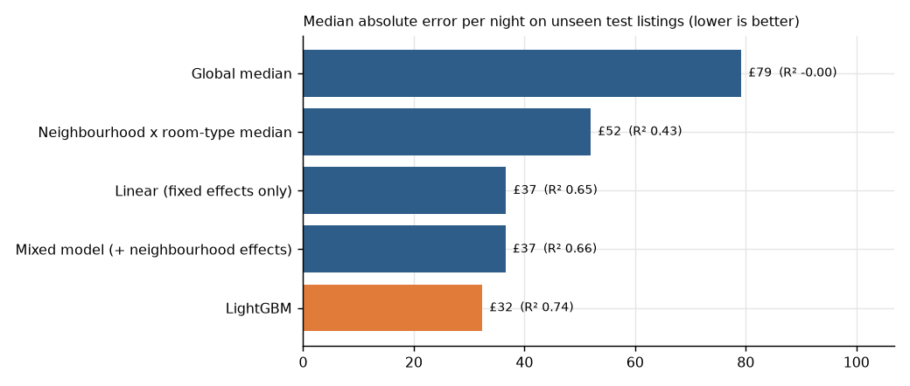
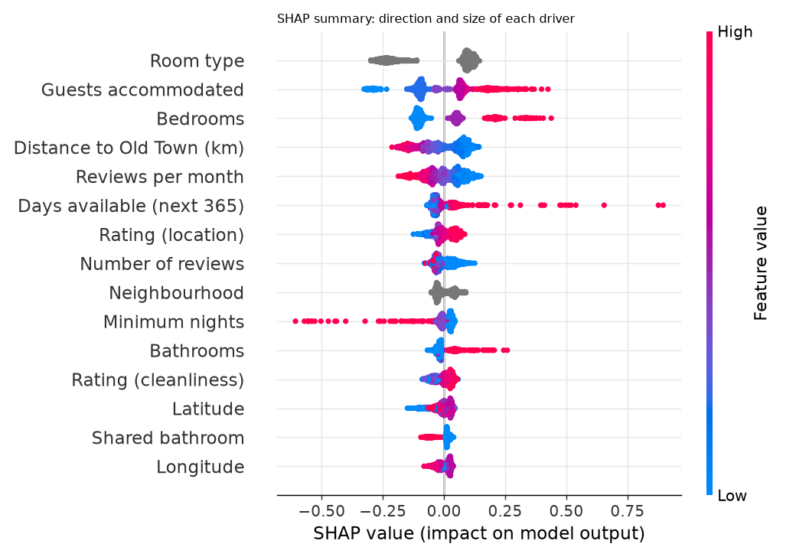
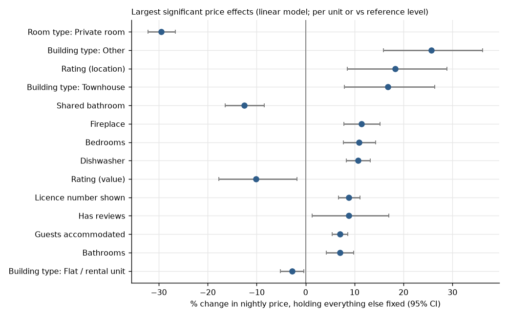
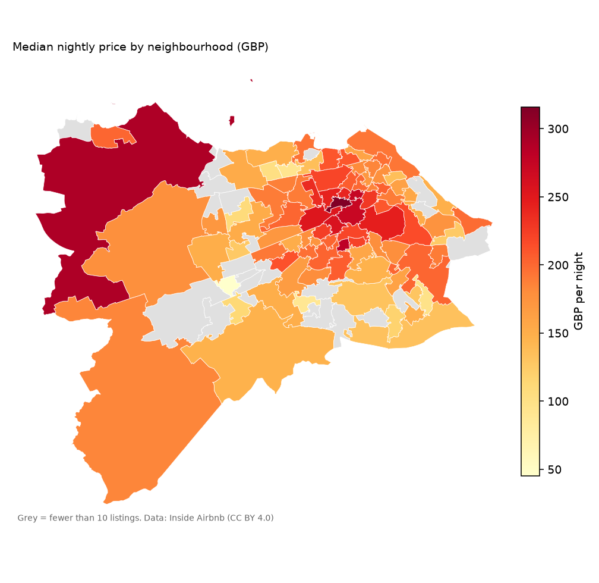
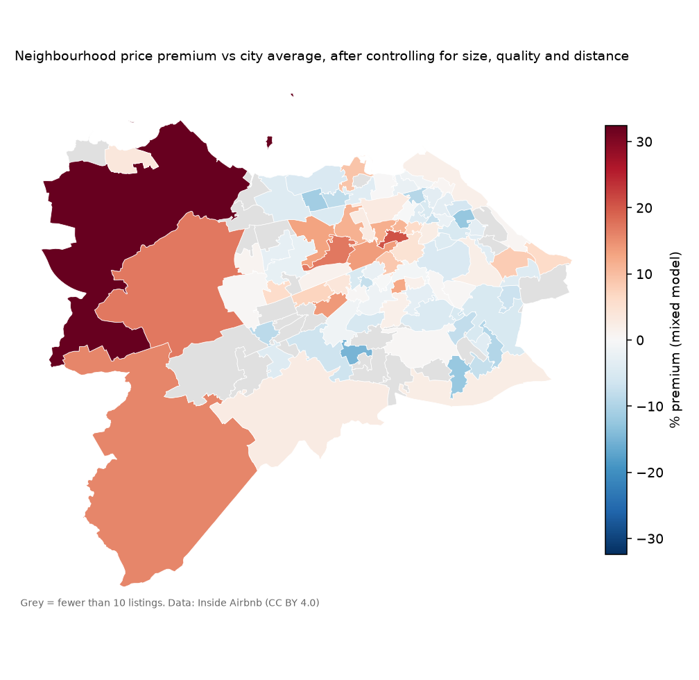
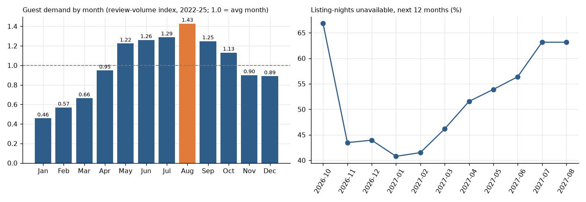

# Findings (auto-generated by `src/report.py`)

Edinburgh Airbnb listings, Inside Airbnb scrape of 2026-09-19 (CC BY 4.0). Prices are nightly list prices as published (treated as GBP).

## Data
* 6,342 listings published; **5,138** used after cleaning (1,097 had no price, 20 priced outside £20-£1,500, 21 long-stay lets, hotel/shared rooms excluded).
* Median nightly price **£215**; middle 50% of listings £148-£303.

| Room type | Listings | Median £/night |
|---|---:|---:|
| Entire home/apt | 3666 | 250 |
| Private room | 1472 | 123 |

## 1. How well can price be predicted?
Test set = 1,028 listings never used for fitting or tuning.

| Model | R² (log price) | Median abs. error (£) | MAE (£) | Median abs. % error |
|---|---:|---:|---:|---:|
| Global median | -0.003 | 79.2 | 105.4 | 35.5 |
| Neighbourhood x room-type median | 0.428 | 52.0 | 83.7 | 25.9 |
| Linear model (fixed effects) | 0.651 | 36.7 | 63.2 | 18.8 |
| Mixed model (+ neighbourhood effects) | 0.662 | 36.6 | 62.5 | 18.9 |
| LightGBM, listing attributes only (no reviews/availability) | 0.694 | 33.5 | 57.8 | 17.7 |
| LightGBM, all features | 0.741 | 32.4 | 53.1 | 16.6 |
| LightGBM, unseen neighbourhoods (5-fold group CV, no neighbourhood feature) | 0.717 | 33.4 | 56.5 | 16.6 |

* The simple neighbourhood x room-type median misses by a median of **£52** a night; gradient boosting brings that to **£32** (R² 0.74 on log price).
* Predicting neighbourhoods the model has never seen costs little accuracy (R² 0.72), so the model is learning transferable drivers rather than memorising areas.
* Dropping reviews/availability (which partly *react* to price) leaves R² 0.69: most of the signal is in the listing itself.

## 2. Price drivers
Gradient boosting + SHAP (average swing in price caused by each driver):

| Driver | Typical swing in price (± %) |
|---|---:|
| Room type | 15.0 |
| Guests accommodated | 12.0 |
| Bedrooms | 11.4 |
| Distance to Old Town (km) | 8.1 |
| Reviews per month | 6.0 |
| Days available (next 365) | 4.4 |
| Rating (location) | 3.4 |
| Number of reviews | 3.2 |
| Neighbourhood | 3.2 |
| Minimum nights | 3.1 |

Linear model, largest significant effects holding other factors fixed:

| Term | % effect | CI low | CI high |
|---|---:|---:|---:|
| room_type: Private room | -29.5 | -32.2 | -26.6 |
| building_type: Other | 25.7 | 15.9 | 36.2 |
| review_scores_location_n | 18.3 | 8.5 | 28.9 |
| building_type: Townhouse | 16.8 | 7.9 | 26.3 |
| shared_bathroom | -12.5 | -16.4 | -8.5 |
| has_fireplace | 11.4 | 7.8 | 15.2 |
| bedrooms_n | 10.9 | 7.7 | 14.3 |
| has_dishwasher | 10.7 | 8.3 | 13.3 |
| review_scores_value_n | -10.1 | -17.7 | -1.8 |
| has_licence_field | 8.9 | 6.7 | 11.1 |

**Caution:** reviews per month, availability and ratings are partly *consequences* of price (cheap places book up and collect reviews). They help prediction but should not be read as levers a host could pull.

## 3. Neighbourhood effects
After controlling for size, quality and distance, neighbourhood explains **9%** of the remaining variation in price; the rest is listing-level. Premiums below come from a mixed model with a random intercept per neighbourhood, which shrinks small areas towards the city average. Only neighbourhoods with at least 10 listings are shown (88 of 111).

Highest premium:

| Neighbourhood | Listings | Median £/night | Premium vs city (%) |
|---|---:|---:|---:|
| Dalmeny, Kirkliston and Newbridge | 28 | 290 | 32.4 |
| New Town West | 176 | 316 | 20.7 |
| Murrayfield and Ravelston | 22 | 201 | 17.2 |
| Ratho, Ingliston and Gogar | 41 | 178 | 17.1 |
| Balerno and Bonnington Village | 15 | 185 | 15.9 |
| Slateford and Chesser | 32 | 213 | 14.0 |
| Deans Village | 348 | 254 | 13.7 |
| Blackhall | 15 | 190 | 13.0 |

Lowest:

| Neighbourhood | Listings | Median £/night | Premium vs city (%) |
|---|---:|---:|---:|
| Colinton Mains and Firrhill | 13 | 90 | -15.1 |
| Restalrig and Lochend | 18 | 162 | -12.5 |
| Gracemount, Southhouse and Burdiehouse | 19 | 118 | -12.4 |
| Muirhouse | 31 | 103 | -11.3 |
| Fernieside and Moredun South | 16 | 97 | -9.6 |
| Bonnington | 35 | 182 | -9.2 |
| The Calders | 16 | 45 | -8.8 |
| West Pilton | 16 | 93 | -8.6 |

Interactive version with a third layer showing every listing against the model's fair price: `outputs/edinburgh_price_map.html`. **458** listings are priced at least 40% above the model's fair price and **159** at least 40% below.

## 4. Seasonality
The current calendar file has no nightly prices, so seasonality is measured by guest demand (review volume, which follows stays) and forward availability.
* Demand peaks in **Aug** (index 1.43; the Festival month) and is lowest in **Jan** (0.46), a 3.1x swing. May-Sep all run above average.
* Over the next 12 months the share of unavailable listing-nights runs from 41% (2027-01) to 67% (2026-10). Unavailable includes host-blocked nights, so this is an upper bound on bookings.
* By weekday, unavailability is highest on Saturday (57%) and lowest on Tuesday (51%).

## Limitations
* One snapshot: prices are asking prices at scrape time, not what guests paid.
* Seasonality is demand-based, not price-based, because the calendar file carries no prices.
* Reviews are a lagged and imperfect proxy for stays; early-year review volumes are also affected by the pandemic recovery (each year is normalised by its own average).
* Associations, not causal effects. Amenities are text-matched from the host's list.
